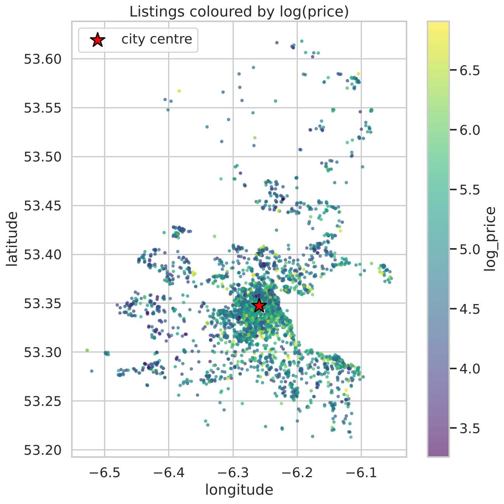
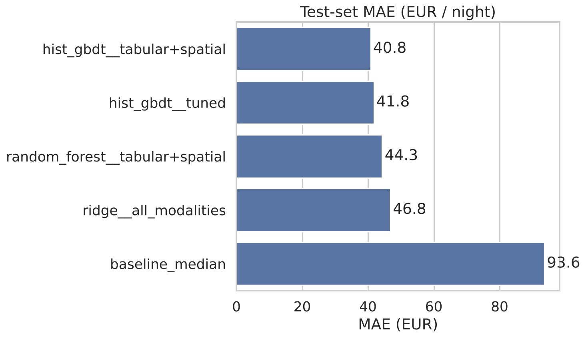
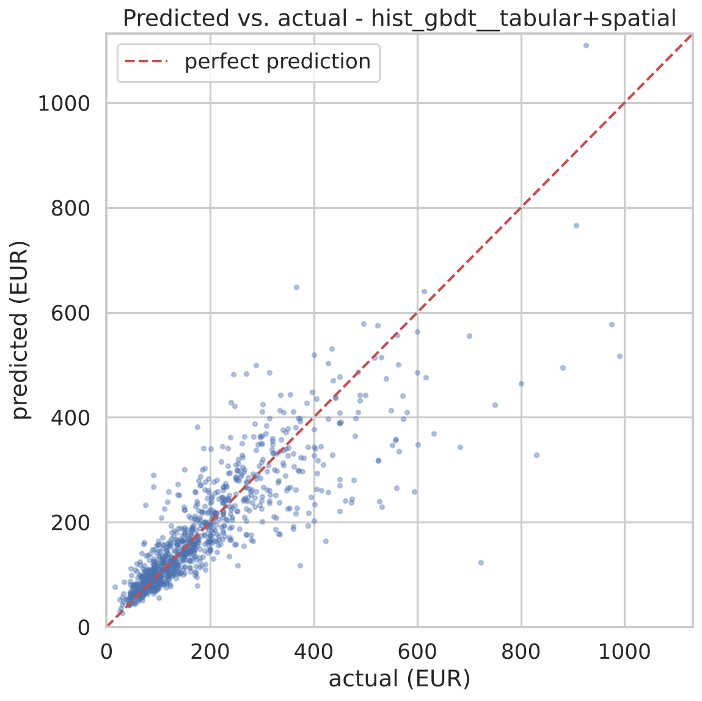
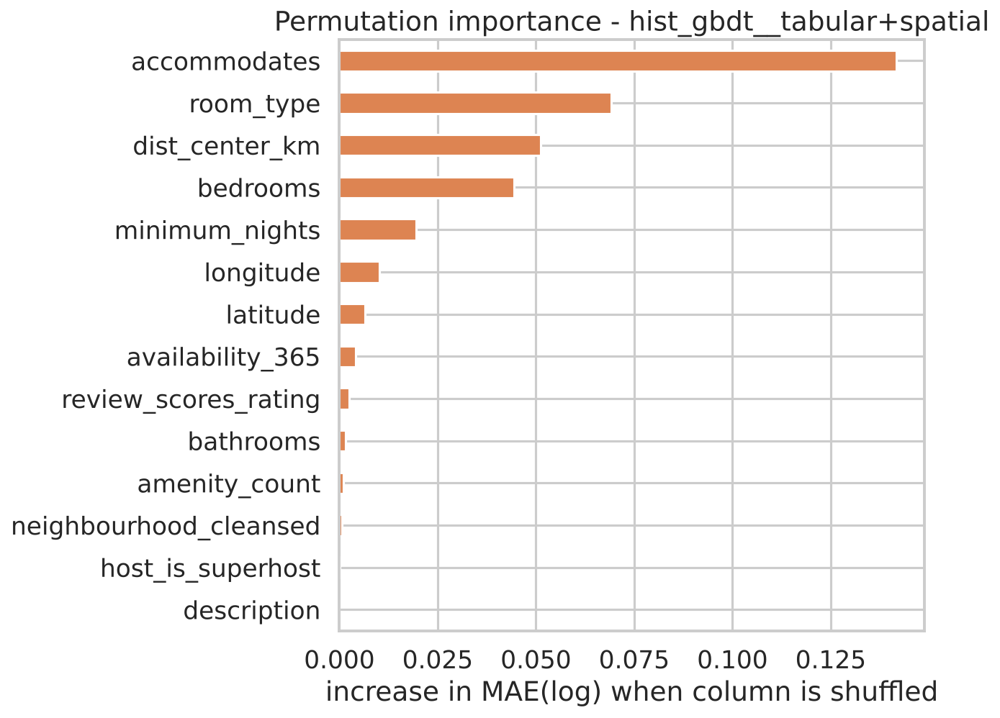

# Airbnb Price Prediction - Dublin

Final project of the Machine Learning course (summer 2026). We predict the **nightly
price** of Airbnb listings in Dublin, Ireland, from data published by
[Inside Airbnb](https://insideairbnb.com/get-the-data/) (snapshot of 16 Sep 2025).

The project combines **three data modalities**:

| Modality | Source columns | How it is turned into features |
|---|---|---|
| Tabular | size, beds/baths, room type, host info, review scores, availability, 18 amenity flags, ... | median imputation + scaling, one-hot categoricals |
| Text | `name`, `description`, `neighborhood_overview` | TF-IDF (1-2-grams) → TruncatedSVD (100 dims) |
| Spatial | `latitude`, `longitude` | coordinates, distance to the city centre, 12 KMeans location clusters |

The target is `log(price)`; all reported errors are converted back to **euros**.

## Results

**Test set (1,040 listings, never used for any decision):**

| Model | Feature set | MAE (€) | Median AE (€) | RMSE (€) | R² |
|---|---|---|---|---|---|
| **Gradient boosting** | tabular + spatial | **40.8** | **21.2** | **71.6** | **0.72** |
| Gradient boosting, tuned | all three | 41.8 | 21.7 | 75.0 | 0.70 |
| Random forest | tabular + spatial | 44.3 | 22.5 | 81.5 | 0.64 |
| Ridge regression | all three | 46.8 | 26.6 | 79.4 | 0.66 |
| Baseline (median price) | - | 93.6 | 59.0 | 144.7 | -0.14 |

The best model is off by about **€41 per night on average** (half of all listings within
€21), less than half the error of the naive baseline.

**What does each modality add?** 5-fold CV error on the training split, MAE of log(price) -
lower is better:

| Model | tabular | + spatial | + text | all three |
|---|---|---|---|---|
| Ridge | 0.267 | 0.263 | 0.251 | **0.251** |
| Random forest | 0.234 | **0.231** | 0.240 | 0.238 |
| Gradient boosting | 0.219 | **0.215** | 0.218 | 0.218 |

- **Location helps every model** - prices clearly fall with distance from the centre.
- **Text helps the linear model a lot, the tree models hardly at all.** The engineered
  tabular features (capacity, room type, amenities) already contain most of what the
  description says, and trees can use them non-linearly; Ridge needs the text to make up for that.
- **Tuning did not pay off:** 30 random hyperparameter settings for gradient boosting
  (on all three modalities) reached CV 0.216 - no better than the default settings with
  tabular + spatial features (0.215). The defaults were already reasonable.
- **Most important inputs** (permutation importance): number of guests, room type,
  distance to the centre and bedrooms.
- **Biggest errors** are expensive listings that look ordinary on paper, e.g. a
  "Double bed in Sullivan" private room listed at €723 (predicted €123). See
  [`worst_predictions.csv`](outputs/metrics/worst_predictions.csv).

## Figures

| | |
|---|---|
|  |  |
| All listings coloured by log(price); the star marks the city centre. | Test error of every model vs. the naive baseline. |
|  |  |
| Predictions vs. real prices (best model). | Which inputs the best model relies on most. |

All figures are in [`outputs/figures`](outputs/figures), tables in [`outputs/metrics`](outputs/metrics).

## How it works

```
data/raw/listings.csv
      │
      ▼
src/data_prep.py   clean prices (≤ €1,000), parse text fields, 18 amenity flags,
                   derived features, frozen 80/20 split stratified by neighbourhood
      │
      ├──► src/eda.py        exploration plots (training split only)       figs 01-06
      ▼
src/train.py       3 models × 4 feature sets, 5-fold CV on the training split
      │            → cv_results.csv + best pipeline per model
      ▼
src/tune.py        randomised search (30 candidates) for gradient boosting
      ▼
src/evaluate.py    one-time evaluation on the test set, baseline, error analysis  figs 10-14
```

`src/config.py` holds paths, the seed and column groups; `src/features.py` builds one
scikit-learn block per modality.

### Design decisions

- **Log target.** Prices are strongly right-skewed (median €135, mean €181). Modelling
  `log(price)` makes errors relative instead of absolute.
- **Outliers.** Listings above €1,000/night (< 1 % of priced listings, up to €19,140) are
  removed; 1,701 listings have no price at all.
- **No leakage.** Everything that is *learned* from data (imputation medians, scaler,
  TF-IDF, SVD, KMeans) sits inside a scikit-learn `Pipeline`, so in cross-validation it
  only ever sees the training folds. `estimated_revenue_l365d` is dropped because it is
  computed from the price.
- **Frozen split, test set used once.** All model choices are made with 5-fold CV on the
  training split; `evaluate.py` touches the test set a single time.
- **Ablation built in.** Every model is trained on `tabular`, `tabular+spatial`,
  `tabular+text` and all three, which shows what each modality adds.
- **Baseline.** Every model has to beat "always predict the median training price".

## Reproduce

```bash
pip install -r requirements.txt
# put the Dublin listings.csv into data/raw/  (see data/README.md)
python src/data_prep.py     # seconds
python src/eda.py           # seconds   -> figures 01-06
python src/train.py         # ~20 min   -> cv_results.csv + models
python src/tune.py          # ~30-60 min (optional)
python src/evaluate.py      # ~1 min    -> test_results.csv + figures 10-14
```

Quick test with the 318-row sample that is included in the repo:

```bash
export AIRBNB_RAW_CSV=data/sample/listings_sample.csv
python src/data_prep.py && python src/train.py ridge && python src/evaluate.py
```

Everything is seeded (`SEED = 42`), so results are reproducible.

## Limitations and ideas

- Photos (`picture_url`) are not used yet - CNN image embeddings would be a fourth modality.
- TF-IDF could be replaced by sentence embeddings (e.g. `all-MiniLM-L6-v2`).
- The listed price is a single snapshot; the `calendar.csv` file would allow modelling
  seasonality.
- Quantile regression could return a price *range* instead of one number.
- This is a predictive model: "listings with a hot tub are predicted to be more expensive"
  is fine, "a hot tub raises the price by X" is not supported.
